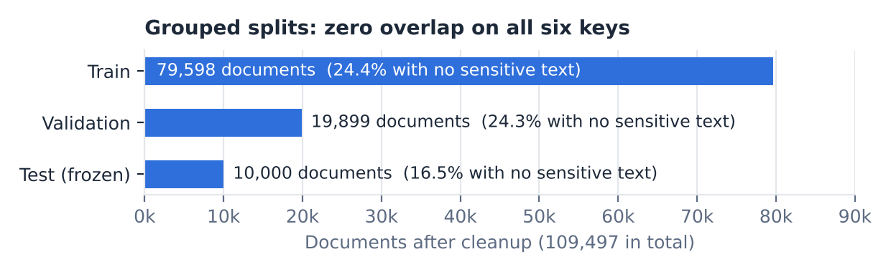
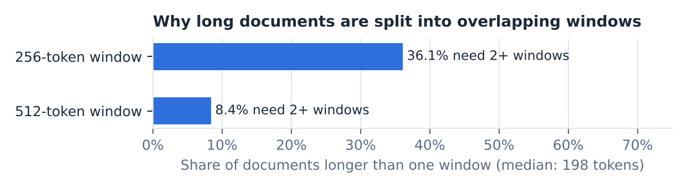
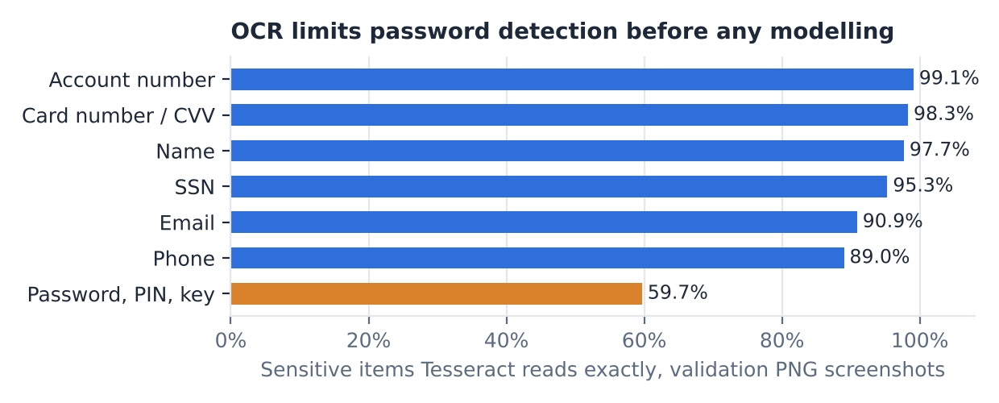

# SafeShare: Data Preparation Summary (Notebook 1)

Godbless Keku, November 2026

This summary follows the three parts of the Data Prep criterion: data cleanup, feature engineering and data insights. Every number comes from Notebook 1 (sections 10 and 14); the notebook's own charts are in sections 11 to 14.

SafeShare finds sensitive text in screenshots and messages so it can be hidden before sharing. The data is [nvidia/Nemotron-PII](https://huggingface.co/datasets/nvidia/Nemotron-PII) (CC BY 4.0), 200,000 synthetic English records, loaded at a pinned revision with an unchanged raw copy and SHA-256 manifests. I mapped 11 of its 55 labels to seven categories: PERSON, EMAIL, PHONE, ACCOUNT_NUMBER, PAYMENT_CARD (cards and CVVs), SSN and PASSWORD (passwords, PINs and API keys). The other 44, such as street addresses and dates of birth, stay as ordinary text: out of scope, and the app tells users so.

## 1. Data cleanup

A record is removed whole if any annotation is out of bounds, empty, or does not match the text it points at. Records are never repaired by guessing, so an uncertain label cannot reach training. All 759 rejected records failed for the same reason: an in-scope annotation did not match its text.

| Step | Rows |
|---|---:|
| Source rows (official train and test) | 200,000 |
| Rejected: annotation text did not match its span | -759 |
| Removed: training rows in the same group as a test row | -8 |
| Removed: exact duplicates | -1 |
| Official test rows not sampled (test fixed at 10,000) | -89,735 |
| **Final documents** | **109,497** |

Records are grouped by source, normalized text and masked template, and whole groups go to one split, so near copies cannot cross from training to test. The overlap between every pair of splits is zero on all six keys (ID, source, group, exact text, normalized text, template). The test split was frozen before any model was tuned, and this rerun rebuilt it exactly: the test document hash (`24104d47…`) and the screenshot record hash (`ec47b71a…`) match the frozen run.

*Figure 1. Documents per split after cleanup. The test split has fewer documents with no sensitive text (16.5% against about 24%), most likely because the official test set it is sampled from has a different mix, so over-masking on test will not be directly comparable with validation.*

## 2. Feature engineering

Each document is split into words, and each word gets a BIO label (begin, inside or outside a sensitive item) for the seven categories. Text is tokenized with the model's own tokenizer (`gravitee-io/bert-small-pii-detection`, pinned revision): the median document has 198 sub-word tokens, about 2.05 per word. Long documents are cut into overlapping windows (stride 64) instead of being truncated, which would hide the end of a document from the model. Figure 2 shows why: at 256 tokens over a third of documents need more than one window, so the app reads text in 512-token windows.

*Figure 2. Share of documents that do not fit in one window, by window size.*

Only 2.0% of words are sensitive (98.0% are labelled outside), so the model is chosen and tuned for recall (F2 score and per-category thresholds), not accuracy.

## 3. Data insights

To test the full screenshot path, 5,076 PNG and JPEG screenshots were rendered from sampled documents, with varied fonts, sizes, themes, layouts, scale and blur; the test split holds out one font and one layout never seen in training. Tesseract 5.3.4 reads them with a character error rate of 3.1% and a word error rate of 3.6%. It finds 96.7% of words, locates 99.96% of sensitive items and reads 92.0% of them exactly. Figure 3 shows the most important insight in the data: passwords, PINs and keys are read exactly only 59.7% of the time, because they mix symbols and look-alike characters. OCR limits password detection before any modelling choice is made.

*Figure 3. Sensitive items read exactly by OCR, by category, on validation screenshots.*

Other insights from Notebook 1 (sections 11 to 13): the entity mix by category, US and international locales in nearly equal numbers, and many subject domains in uneven amounts.

## 4. Running the project

### Requirements
- A Google account with Colab. A CPU runtime is enough (no GPU); the run takes about 2 hours, mostly OCR on the rendered screenshots.
- A Google Cloud project with billing turned on, and a Cloud Storage bucket in it. By default (`UPLOAD = True`) the notebook uploads the data it builds to that bucket.
- These Colab Secrets (key icon on the left, **Secrets**; turn on **Notebook access** for each):

| Secret | Value |
|---|---|
| `GCP_PROJECT_ID` | your Google Cloud project ID |
| `GCS_BUCKET_NAME` | your bucket name |
| `GCS_DATASET_LOCATION` | `gs://<your bucket>/safeshare/data` |
| `HF_TOKEN` | optional: a Hugging Face token (read access); the dataset and tokenizer are public, a token only avoids download rate limits |

- Nothing else: no GitHub token and no files to upload. The code, the dataset and the tokenizer are public.

### Steps
1. Open the notebook [`notebooks/01_SafeShare_Data_Prep.ipynb`](https://colab.research.google.com/github/gbkeku/safeshare-data-prep/blob/main/notebooks/01_SafeShare_Data_Prep.ipynb) in Colab (this link, or the Open in Colab badge at the top of the notebook), then Runtime > Change runtime type > **CPU**.
2. Add the Colab Secrets above.
3. Run every cell from top to bottom (Runtime > Run all) and keep the tab open. Section 1 downloads the code from this repository, which is public, so no token is needed. Section 3 asks you to sign in to Google Cloud once.
4. At the end, section 15 uploads the raw data, the prepared data and the screenshots to your bucket, each with a SHA-256 manifest, and publishes a receipt last (`<GCS_DATASET_LOCATION>/receipts/<run ID>.json`), which it also downloads. Every file is written create-only, so a run never replaces an earlier one.

**To run without Google Cloud:** set `UPLOAD = False` in section 3. Then no secrets are needed, nothing is uploaded, and section 15 asks for Google Drive access instead, to save a copy of the prepared data and a run record.

## 5. Responsible data use

The records are synthetic, so no real person's data was collected; the data is still kept in a private Cloud Storage bucket and is not redistributed. The data does not record where names come from, so fairness across name origins cannot be measured with it. Some labels are wrong in meaning while matching their text (found in the Week 4 error review); they are reported, not hidden. Details are in `RESPONSIBLE_AI_DATA.md`. Uploading never replaces an earlier run, because every file is written create-only, so the frozen data run (`20261111T013302Z-e38b2785`) used by every later notebook stays as it is.
